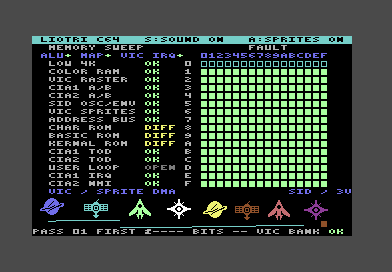

# Liotri C64 hardware test

Liotri is an EasyFlash diagnostic cartridge for the Commodore 64. It boots
with all three system ROMs missing and checks the low 4K of RAM before its
first subroutine call. When RAM or an address multiplexer fails, the VIC can
read both the fault message and its font directly from the cartridge.

We developed Liotri with c64-hw-simulator, a C64 hardware emulator that let
us inject faults into a simulated PAL board (ASSY 250407) and verify the
cartridge’s diagnosis. Removing DRAM chips U24 and U21 made Liotri highlight
D6 and D0 on screen and flash twice for D6. Disconnecting CIA1’s IRQ pin
left its timer check at OK while its interrupt check reported BAD.
[c64-hw-simulator](https://github.com/antirez/c64-hw-simulator)

On a healthy machine the dashboard shows the quick checks first, then maps
the RAM sweep one page at a time. After a clean pass, the eight test sprites
orbit a live trace of SID voice 3 while the SID plays a three-voice tune.


## Run the cartridge

The ready-to-use image is [liotri.crt](liotri.crt). The original Kung Fu
Flash and Kung Fu Flash 2 both support its EasyFlash format. Copy
`liotri.crt` to a FAT-formatted microSD card and select it in the cartridge
launcher. [Kung Fu Flash documentation](https://github.com/KimJorgensen/KungFuFlash/tree/v1.50#supported-cartridges) · [Kung Fu Flash 2 documentation](https://github.com/KimJorgensen/KungFuFlash2/tree/v2.04#supported-cartridges)

On an EasyFlash cartridge, program the image, enable the boot jumper and
power on. RESET starts a fresh run and clears the recorded faults. The
586220 harness enables the optional external port checks.

For a simulated run, open the image in an emulator that supports EasyFlash.
These examples use an EasyFlash-capable build of
[c64-hw-simulator](https://github.com/antirez/c64-hw-simulator).

```sh
c64-hw-sim liotri.crt
c64-hw-sim --harness liotri.crt
c64-hw-sim --fault U5:removed liotri.crt
```

The timings and fault reports below were verified on the simulated PAL ASSY
250407. Physical-board validation is still pending. The cartridge uses the
standard EasyFlash reset mapping. [EasyFlash Programmer’s Guide](https://skoe.de/easyflash/files/devdocs/EasyFlash-ProgRef.pdf)

## Reading a run

The left column reports measurements as they finish. Two dots mean pending.
On the simulated board, the low RAM, CPU arithmetic and banking checks,
address lines, color RAM, CIA timers, interrupt paths, SID readbacks and
initial VIC collision checks are visible by frame 25, about half a second.
The three checks above the RAM grid use `.` for pending, `+` for pass and
`!` for a fault. The ROM checks finish around 1.3 seconds and
the first full memory result appears by 8.4 seconds. Wall-clock time
depends on the speed of the simulator.

The grid is a physical address map. The row and column are the two hex
digits of the page number. Row D, column 3 covers $D300–$D3FF, including
the RAM behind the VIC register window. The first row shows the low 4K
qualified on startup.

| Map tile | Measurement |
|---|---|
| Dot | Waiting for this pass |
| Stripes | Wrote the initial pattern |
| Inset square | Checked the pattern and wrote its inverse |
| Solid square | Final read completed |
| Red cross | A read from this page differed on this or an earlier pass |

The last dashboard row summarizes the long-running tests. `PASS` is the RAM
sweep number. `FIRST` is the first failing RAM address, or `$----` if none has
been recorded. `BITS` is the accumulated mask of differing data bits, or `--`
before any failure. `VIC BANK` reports the four-bank VIC-II fetch test: `..`
means pending, `OK` means all four banks produced their expected collision
masks, and `BAD` means at least one bank did not.

`FIRST` holds the first failing address from a deep sweep. `BITS` accumulates
the XOR of expected and observed data with a bitwise OR over all failures.
For example, `FIRST $D34A   BITS 05` means the first mismatch occurred at
$D34A and differences have occurred on D2 and D0. Both fields and the red
page marks survive subsequent passes. After a sparse address-bus failure, the cartridge
finishes the quick checks, inhibits the deep writes, and switches to a second
ROM-backed screen. Nine flashes identify this case. The highlighted address
is the first conflicting probe, or the base if the returned tag was invalid.

When the first full RAM pass finishes without a recorded fault, the
dashboard shows **NO FAULTS FOUND** and explains that RAM tests repeat
until RESET to catch intermittent faults. **CHECKS OK** stays visible during
subsequent sweeps. A later mismatch immediately changes it to **RAM FAULT**
and records the address and differing bits.

The top row shows the keyboard shortcuts and their current settings.
Press **S** to mute or restore sound and **A** to hide or show the animated
sprites. Both start on after RESET. `H:VOICE 0` plays all three SID voices.
Press **H** to solo voice 1; each further press selects voice 2, voice 3,
then voice 0 again. The `H:VOICE` field shows the selected channel. The keys work with the cartridge font and
a working CIA1 keyboard path. The SID scope keeps sampling while muted, and
both VIC collision tests run with either animation setting.

Press **K** to pause for the keyboard-matrix test. Unplug both joysticks,
release K, then press and release each labeled key. Gray means untested,
green means currently held, and blue means previously detected and now
released. LSH/RSH identify the two Shift keys, SHLK is Shift Lock, and
CTRL, CMD and STP mean Control, Commodore and RUN/STOP. The two C labels
beside RSH are the down/up and right/left cursor keys. Hold RUN/STOP and
RETURN together for two seconds to exit. The dashboard and recorded results
are restored, and a fresh RAM pass
begins because the screen backup uses memory covered by the sweep.
RESTORE uses NMI and is not included in this matrix test. RUN/STOP + RESTORE
returns safely to the running cartridge; it does not invoke the stock KERNAL
BASIC warm start.

Either joystick port controls hardware sprite 3 on the dashboard. Directions
move it within the visible area, including diagonals. Holding Fire on either
port turns it red; releasing Fire restores its white color. After ten seconds
without direction or Fire input, it rejoins the dashboard animation. Sprites must be
enabled with **A** to see it.

On a clean pass, the memory map briefly becomes a large SID scope. Its
sixteen columns sample the actual OSC3 register. The eight hardware sprites
orbit the trace while a triangle bass, pulse arpeggio and sawtooth lead play
on the SID. The lower strip shows 32 more OSC3 samples and an ENV3 color
indicator. A physical SID drives the audio output. The test simulator
displays the visual instruments and has no host speaker output.

## When the stack or screen RAM is broken

Liotri runs with the BASIC, KERNAL and character ROM sockets all empty.
The first dashboard font comes from the cartridge. The VIC fetches it from
qualified RAM. This also supplies the sprite test with known foreground pixels
before U5 has been checked.



The cartridge takes the reset vector in Ultimax mode. The 6510 walks ones
and zeroes through a single byte at $02. It then writes address-dependent
patterns and their complements throughout $0002–$0FFF before the first JSR.
$0000 and $0001 are the 6510’s on-chip direction and port registers.

A mismatch takes a stackless reporting path. The VIC reads both the screen
matrix and its font from cartridge ROM. The highlighted rows show differing
data bits. The screen and physical cartridge LED repeat the flash count for
the highest reported bit. Counting works even when the text or colors are
unreadable. The table uses the 250407 board designators.

| Flashes | Bit | DRAM | Flashes | Bit | DRAM |
|---:|---|---|---:|---|---|
| 1 | D7 | U12 | 5 | D3 | U10 |
| 2 | D6 | U24 | 6 | D2 | U22 |
| 3 | D5 | U11 | 7 | D1 | U9 |
| 4 | D4 | U23 | 8 | D0 | U21 |

A row identifies a data path worth probing. DRAM inputs, outputs, address
multiplexers and control signals can produce similar mismatches. Later C64
boards use different DRAM organizations. A machine needs enough clock,
reset, CPU, PLA and cartridge-bus functionality to fetch instructions.
Video reporting also needs a functioning VIC output path.

## What the checks exercise

| Check | Operation |
|---|---|
| 6510 ALU | Binary ADC/SBC exercise carry and borrow across all eight bit positions, signed overflow, zero and sign. Rotate through carry in both directions. Packed-BCD addition and subtraction check decimal result and carry across nibble and byte boundaries. |
| CPU memory map | From $0200, exercise all eight LORAM/HIRAM/CHAREN combinations twice. Drive each bit from $01, then hold its latch low and use the $00 direction register to release the high bits to the board pull-ups. Compare cartridge ROM with a DRAM marker beneath it. Two complementary writes distinguish the VIC register and its mirror, DRAM and the read-only character window. The separate CRC judges the character ROM contents. |
| Address bus | Write 17 distinct tags at a base address and all sixteen single-bit neighbours, then read them back with cartridge, ROMs and I/O switched out. |
| Deep RAM | First sweep writes a tag derived from both address bytes and a seed across $1000–$FFFF, verifies and inverts it in descending order, then verifies the inverse in ascending order. Subsequent passes alternate address patterns with a six-element March C− on this 60K. The low 4K holds the qualified workspace and display. |
| Color RAM | Two full writes and separate verification reads of all 1,024 nibbles. The tag folds all ten address bits into four data bits. Only D0–D3 are compared. |
| ROMs | CRC-16/CCITT-FALSE over the complete CPU-visible images. Stock BASIC is A512, character ROM F542 and KERNAL revision 3 304F. DIFF means a different signature. A legitimate replacement ROM can produce it. The dashboard starts with its cartridge font. Only a matching character ROM checksum enables copying stock glyphs to the same screen font RAM. The VIC can display every result with U5 removed. |
| VIC-II | Bounded raster progress check. All eight sprites overlap each other and a solid background target. Repeat with alternating sprites enabled, check the read-to-clear latches, then separate the sprites and require the overlap to disappear. |
| VIC raster IRQ | Wait for a raster match with VIC interrupts masked and the CPU accepting IRQs. Enable the pending source, require entry through the hardware vector, verify the source bits and acknowledge them. The CIA1 IRQ and CIA2 NMI tests run separately. |
| VIC banks | Once the first deep sweep finishes, put a different pair of opaque sprites in each 16 KiB bank. Select the four banks with CIA2 and require sprite collision masks $03, $0C, $30 and $C0 respectively. The footer reports the VIC’s actual memory fetches. |
| CIA1 and CIA2 | Timer A underflows clock timer B in one-shot mode. Check the source bits and read-to-clear behavior, then deliver actual timer interrupts to ROM IRQ and NMI handlers. Both time-of-day clocks must move. Raster and device waits are bounded. |
| SID | Hold voice 3’s sawtooth at zero with TEST, run it into its upper half, then set its frequency to zero. Require OSC3 to hold the same nonzero value for 32 reads and return to zero when TEST is asserted again. Gate the envelope and require ENV3 to rise and fall. The audible phrase exercises all three voices; `H:VOICE 0` plays them together and **H** selects each channel alone. Analog output and filters require listening or probing. |
| 586220 harness | Look for mirrored user-port PB pairs in both directions. When detected, independently exercise keyboard and joystick paths using the motor-controlled switch, both paddle pairs through U28, IEC ATN-to-CLK transitions and the cassette SENSE-to-READ edge on CIA1 FLAG. |

The March C− sequence is **write 0**, **up read 0 / write 1**, **up read 1 /
write 0**, **down read 0 / write 1**, **down read 1 / write 0**, **read 0**.
The test uses $00 and $FF byte backgrounds. Graphics, music and status
updates run between pages, after the normal memory map has been restored.
The VIC collision verdict comes from its hardware latches. [Commodore 64 Programmer’s Reference Guide, graphics](https://www.commodore.ca/wp-content/uploads/2018/11/c64-programmers_reference_guide-03-programming_graphics.pdf)

`USER LOOP OPEN` is expected without a harness. A partly working set of PB
pairs produces BAD. When a loop is recognized, the strip shows individual
KEY, JOY, POT, IEC and TAPE results with + for pass and ! for fail. Loss of
all identifying pairs can look like an unplugged harness.

## From repair symptoms to fault injection

Commodore lists the 6510, PLA, VIC-II and DRAM among the possible causes
of a blank screen. Its troubleshooting guide also points to U14 for some
garbled displays and U26 for characters rendered as blocks. Repairer Ray
Carlsen observed that a character-ROM fault can spoil the lettering while
a cartridge still runs. Liotri uses
its own font and measures the CPU and video address paths separately.
[Commodore service manual](https://www.devili.iki.fi/Computers/Commodore/C64/Service_Manual/Page_14.html) · [Ray Carlsen’s repair notes](https://portcommodore.com/rcarlsen/cbm/c64/c64-ic.txt)

The following are observed results on the simulated 250407. Component
numbers and pin numbers refer to this board.

| Injected fault | What Liotri showed |
|---|---|
| Open U7 pin 29 (LORAM), pin 28 (HIRAM) or pin 27 (CHAREN), one at a time | `BANK MAP FAILED` at $01=$36, $35 and $33 respectively. Holding CHAREN low instead failed at $37. The error screen still worked with I/O hidden. |
| Make P0’s output driver stay enabled in a separate simulator build | The data-register sweep passed. Releasing P0 via the direction register produced `BANK MAP FAILED` at $00=$28. |
| Open U17 pin 8 (PLA LORAM input) | The same $36 failure as an open LORAM output at U7. The report identifies a path to probe at both ends. |
| Open U19 pin 8 (VIC IRQ output) | `VIC IRQ!` with VIC raster movement, CIA1 IRQ and CIA2 NMI all passing. |
| Hold U7 pin 3 (shared IRQ input) high or low | Both VIC IRQ and CIA1 IRQ failed. CIA2 NMI still passed. Holding U7 pin 4 (NMI) high produced the complementary result. |
| Hold U2 pin 2 (CIA2 PA0) high, or open U14 pin 2 | `VIC BANK BAD` with the ordinary eight-sprite collision test passing. The default video bank still displayed the dashboard. The previous cartridge reported a clean pass with U2 pin 2 held high. |
| Remove U18 or hold its chip select (pin 8) high | `SID OSC/ENV BAD`. The held-phase check rejects bus activity from an empty or unselected SID socket. |
| Disable BCD correction in the simulated CPU core | `ALU!` while banking, interrupts and the RAM sweep still ran. |
| Suppress signed overflow on binary SBC in a separate core build | `ALU!` with `MAP+` and `VIC IRQ+`. These internal CPU faults are functional models. Their frequency on real 6510s is unknown. |

A CPU bank failure halts the cartridge before deep writes can reach the
wrong device. The screen gives the value written to $01 or $00 and the
window that disagreed. A VIC bank failure leaves the CPU running its RAM
sweeps. U7 drives the banking inputs to the PLA. CIA2 and U14 select the
VIC’s DRAM bank.
[The C64 PLA Dissected](https://skoe.de/docs/c64-dissected/pla/c64_pla_dissected_a4ds.pdf) · [Commodore Programmer’s Reference Guide, graphics](https://www.commodore.ca/manuals/c64_programmers_reference/c64-programmers_reference_guide-03-programming_graphics.pdf)

To reproduce the video-bank fault on the supplied cartridge, run the following command.

```sh
c64-hw-sim --headless 465 --text --fault U2.2:vcc liotri.crt
```

A removed 6510 produced no cartridge report in the simulator. On a board
that gives no report, clock, reset and instruction fetch need external
measurement. The SID readbacks also leave the analog audio path to be
checked at the output. [MOS 6581 register description](https://gryzor.info/imgs/9/9d/Mos_6581_sid.pdf)

## Build and verify

To rebuild from source, run `make -B` in the repository root with GNU Make
and 64tass on your path. The release was assembled with 64tass
1.60.3243. You can select another installation with
`make -B TASS=/path/to/64tass`.

The assembly entry point includes the CPU probes, font, sprite data and
harness tests. [src/liotri.asm](src/liotri.asm) · [src/cpu.asm](src/cpu.asm)

The assembler emits the 64-byte CRT header,
two 8 KiB EasyFlash CHIP packets, and the CPU vectors directly into
`liotri.crt`. The cartridge contains its own repair font.

The regression suite uses Python 3 and a separate EasyFlash-capable build of
c64-hw-simulator. By default it runs `c64-hw-sim` from your path. To select
a local build and test the supplied cartridge, run the following from the
repository root.

```sh
C64_HW_SIM=/path/to/c64-hw-sim python3 tests/liotri.py
```

The suite reads the monitor output and flash reports. It exercises missing
ROMs, interrupted data and address paths, SID and CIA failures, broken harness
contacts, keyboard toggles, the clean-pass report, and a deliberately changed
byte under I/O. With the character ROM removed, it decodes screenshots using
the cartridge’s own glyphs. For the optional arithmetic fault case, build
a separate copy of the simulator with `.bcd_disabled = true` in the
`m6502_desc_t` passed to `m6502_init` in `src/c64.c`. Set
`C64_HW_SIM_NO_BCD` to that executable alongside the normal `C64_HW_SIM`.
Both run the same cartridge image.

## License

Liotri’s source code and cartridge image are released under the [MIT License](LICENSE).
